<p align="center">
  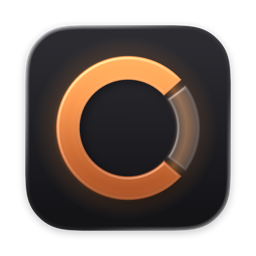
</p>

<h1 align="center">Copperlight</h1>

<p align="center">
  <b>A warmer light than Spotlight.</b><br>
  The keyboard launcher for your Mac: apps, files, math, clipboard history, notes and windows, all from one field.
</p>

<p align="center">
  <a href="https://github.com/ramosrob/copperlight/releases/latest"></a>
  
  <a href="LICENSE"></a>
  <a href="https://github.com/ramosrob/copperlight/actions/workflows/test.yml"></a>
</p>

<p align="center">
  <a href="https://copperlight.app"><b>copperlight.app</b></a> ·
  <a href="#install">Install</a> ·
  <a href="docs/guide.md">Guide</a> ·
  <a href="FEATURES.md">Everything it does</a>
</p>

<p align="center">
  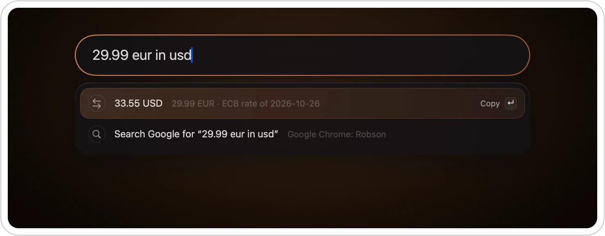
</p>

Press <kbd>⌥ Space</kbd> anywhere, type, press <kbd>Enter</kbd>. Copperlight opens apps and files, does math and
currency, converts units and time zones, translates, keeps your clipboard history, moves windows, plays and pauses
your music, pastes snippets, opens System Settings pages, chooses menu items in the app you're in, and runs your own
commands and scripts. One field does it all, and anything that isn't a search is a command typed after a colon
(`:left`, `:quit saf`), so there are no shortcuts to learn.

## Why Copperlight

- **One field for everything.** No windows to open, no menus. The best match is already selected, what you pick
  ranks higher next time, and what you picked for a few letters comes first for them: `ss` ↵ Slack once, and `ss` is
  Slack from then on. Type a tool's name and press Tab (`tra` ⇥) and it turns into a chip, so you always see
  where your words are going.
- **Keyboard first.** Every result and every action is a few keystrokes from <kbd>⌥ Space</kbd>, even the menus of
  the app you're in (`:export pdf`). Select text anywhere first and it's already typed; <kbd>↑</kbd> in the empty
  field brings back what you ran before. The mouse is optional.
- **Already there.** Open it and what's next is waiting: the call about to start (Enter joins), the pomodoro, timer
  or stopwatch you have running, reminders that are due (Enter completes them), and the apps you usually open at this
  time of day. Nothing to type.
- **Yours.** Your settings live in one plain-text file you can read, edit and keep in git. Add your own commands,
  quicklinks, snippets and scripts.
- **Private.** No account, no telemetry, no AI service. What it keeps stays on your Mac.
- **Free and open source.** GPL-3.0: read it, change it, share it.

## Built in

The little tools you'd otherwise install one by one, a keystroke away. No extra apps, no windows to manage.

| Tool | What it does |
|---|---|
| **Clipboard history**<br>`clip` | Everything you copy, text and images, searchable. Enter pastes it into the app you were in. Passwords are never recorded. |
| **Floating notes**<br>`note`, `note milk` | Glass notes that float above your windows and save as you type, as many as you like, each titled by its first line. `note` lists them, last edited first; Markdown is styled as you type, and checkboxes tick with a click. |
| **Pomodoro**<br>`pomo`, `pomo 50` | A focus timer that counts down in the menu bar and tells you when it's done. |
| **Timer**<br>`timer 10 min tea`, `timer until 15:30` | A countdown for anything else, with what it's for: in the menu bar, with a sound when it's done. |
| **Stopwatch**<br>`stopwatch` | Counts up in the menu bar; stopping it tells you the time. |
| **Quick capture**<br>`add todo`, `add event` | Reminders, calendar events and note lines, with the date read from what you type: `add todo call mom tomorrow 5pm`. |
| **Snippets**<br>`sig`, `reply Ana` | The text you type over and over, with placeholders for the date, the clipboard or a name. |
| **Meetings**<br>`meetings`, `agenda` | The rest of today's calendar, a copper badge on what starts within the hour, and Tab for the details. A few minutes before a call, it's already there when you open Copperlight: Enter joins. |
| **Your week**<br>`week`, `next week` | The whole week at a glance, a column a day with its events and their times, today on copper. |
| **Contacts**<br>`ana` | People from your contacts as you type their name. Enter messages them; Tab lists every way to reach them: call, FaceTime, WhatsApp, email, or copy their number. |
| **Due reminders**<br>`due` | What's overdue or due within the hour waits when you open Copperlight, with a copper badge. Enter completes it. |
| **Browser tabs**<br>`tabs`, `inbox` | The tabs open in your browsers, found by their title or address. Enter switches to the tab instead of opening the page again. |
| **Dictionary and translation**<br>`define`, `translate` | The Mac's dictionary and on-device translation, without opening an app. Copy something and type `translate`. |
| **Music and sound**<br>`:play`, `:mute`, `:output` | Play, pause and skip whatever is playing, mute, set the volume, and switch between speakers and headphones. |
| **Stocks**<br>`stock AAPL` | The price now, today's change and the week's chart across the whole card. Enter opens the stock on Yahoo Finance. |
| **Weather**<br>`weather` | Now, the next hours and five days across the card, for where you are or any city. Enter opens Weather. |
| **Lookups**<br>`ip`, `battery`, `disk`, `port 3000` | Your IP addresses, the battery and its health, free space on each disk, and what's listening on a port, with Enter to end it. |
| **Speed test**<br>`speed` | Your internet's download and upload speed and its latency, measured by macOS's own tool against Apple's servers, when you press Enter. |
| **Processes**<br>`cpu`, `memory` | What's using the processor or memory, the busiest first, with each one's app icon. Enter ends a process, or quits an app, after asking. |
| **Keep awake**<br>`:awake`, `:awake 2h` | Keeps your Mac and its displays awake until you say so, or for a while (`:awake 2h`, `:awake until 18:00`), with a sun in the menu bar while it's on. |
| **Text tools**<br>`json`, `uuid`, `b64`, `hex` | Format JSON, make a UUID or a password, encode text, convert colors and timestamps. |
| **Colors**<br>`#c87533`, `pick color`, `colors` | A color on a band, with how it reads on white and black, in hex, RGB and HSL and a step lighter and darker. Pick one off the screen and its hex is copied; `colors` lists the ones you picked. |
| **QR codes**<br>`qr` | A QR code of a link or any text, or of what you copied, big, with copy, save to Downloads and copy the link beside it. |
| **Text from the screen**<br>`copy text` | Drag over anything, a video, a picture, an error you can't select, and its text is copied, read on your Mac. A link in a QR code opens. |
| **Spelling**<br>`spell definately` | The word spelled right, and the other guesses; a sentence comes back corrected. |
| **Large Type**<br>`large 555-0100` | Any text across the screen, big enough to read from across the room. |
| **Emoji**<br>`emoji party` | Every emoji by name, pasted where you are. |
| **Screenshots**<br>`screenshot`, `record` | The macOS screenshot toolbar, ready to capture or record. |

## A closer look

**Press Tab, and it's a tool.** Type the start of a tool's name and press Tab: it turns into a chip, and everything
you type after it goes there, with nothing else in the way. `translate hello world to ger` ⇥ even moves the language
into the chip. A space is still only a space, so a search for `stock_Apple.pdf` stays a search.

<p align="center">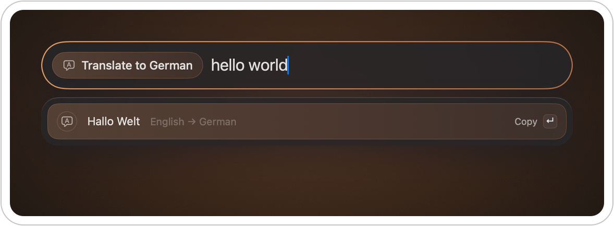</p>

**Contacts.** Type a name and Enter messages them. Tab goes into the person instead: message, call, FaceTime,
WhatsApp, email or copy, with their card beside the list. Read on your Mac, never sent anywhere.

<p align="center">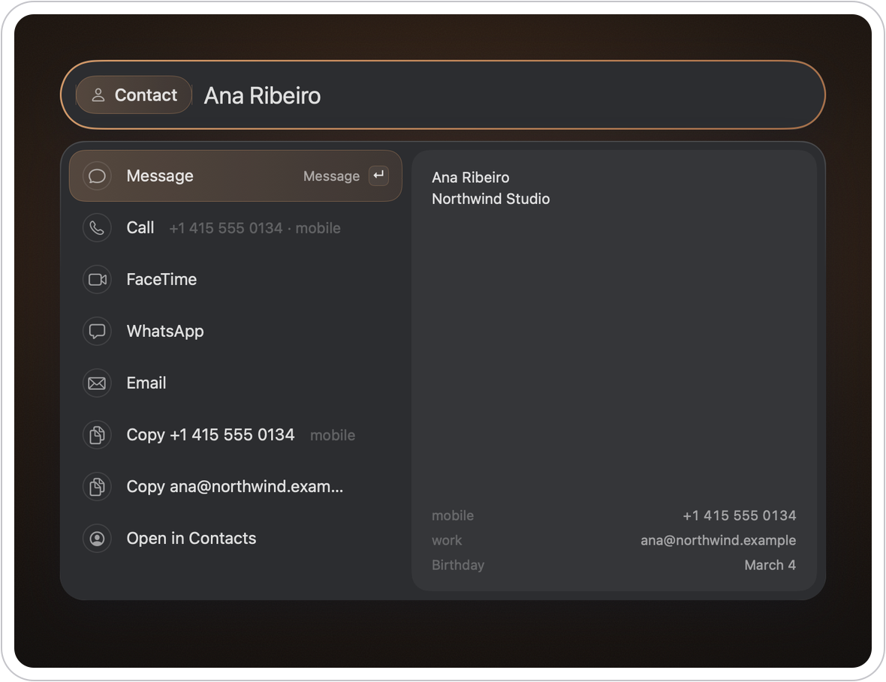</p>

**What's next, when you open it.** No need to type: the call about to start is already selected, Enter to join.
Below it, whatever you have running, the time ticking; reminders that are due, Enter to complete them; and the apps
you usually open at this time of day, learned on your Mac from what you open with Copperlight.

<p align="center">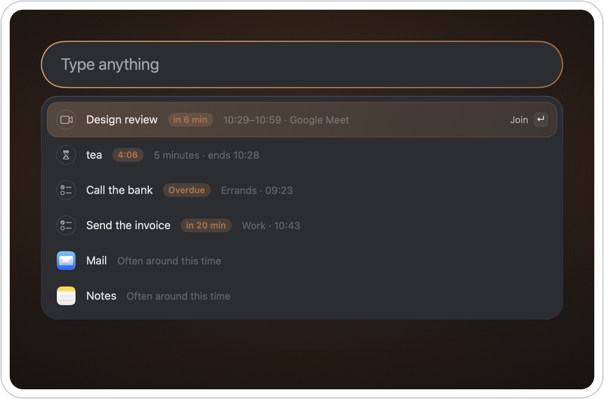</p>

**Answers in their own shape.** Most results are rows, with a preview beside them when there's more to read. An
answer that reads better big takes the card instead, laid out for what it is: a stock, a word's entry or your internet
speed across the whole card, a QR code beside what you can do with it, a color on a band over its notations.

**Stocks.** `stock aapl` ⇥: the price and today's change, the week's chart with yesterday's close dashed across it,
and the numbers under it, from Yahoo Finance. Copperlight asks only when you use the chip. Enter opens it there.

<p align="center">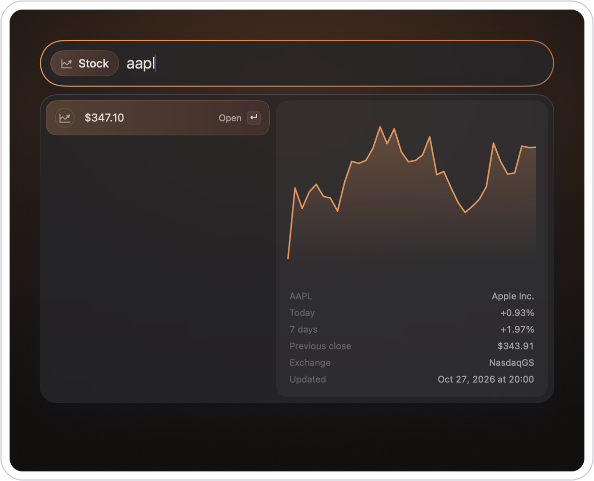</p>

**QR codes.** `qr` ⇥ and a link, or nothing for what you copied: the code, big, with what it's of. Enter copies the
picture; below it, save it to Downloads or copy the link.

<p align="center">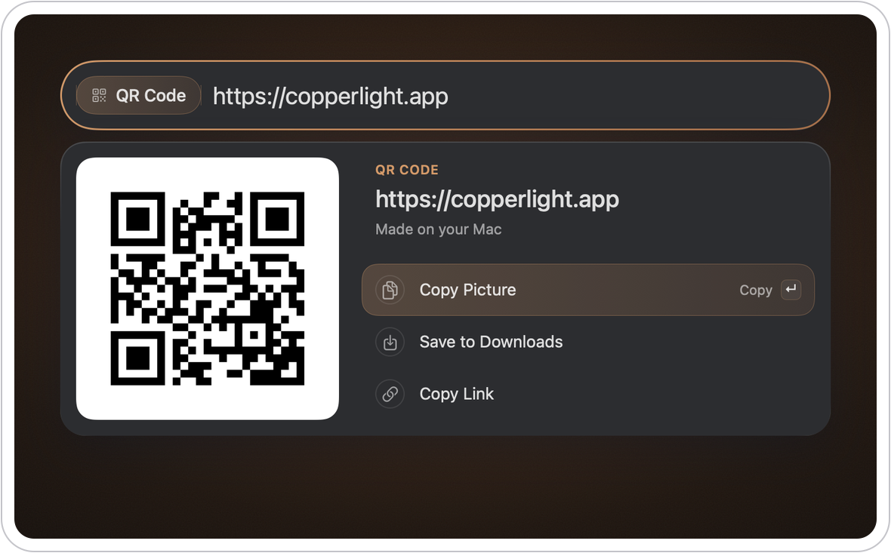</p>

**Colors.** `#c87533`, `rgb(…)` or `hsl(…)`: the color on a band with how it reads on white and black, and under it
the other notations and a step lighter and darker, each a row to copy. `pick color` takes one off the screen and
copies its hex; `colors` lists the ones you picked, the one you're on on the band.

<p align="center">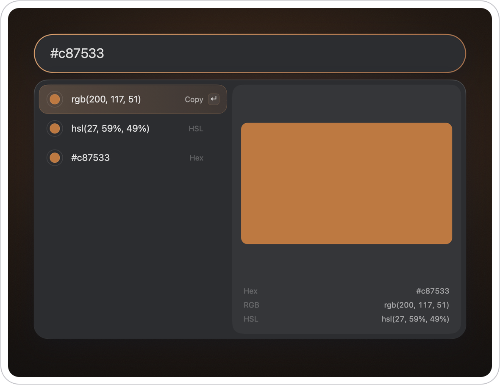</p>

**Dates, the way you'd ask.** `days until christmas`, `in 3 weeks`, `monday in 3 weeks`, `time in 4 hours`; `dec 25`
alone says it's a Friday. Before you finish typing, `in 3` already answers in days, weeks, months and hours.

<p align="center">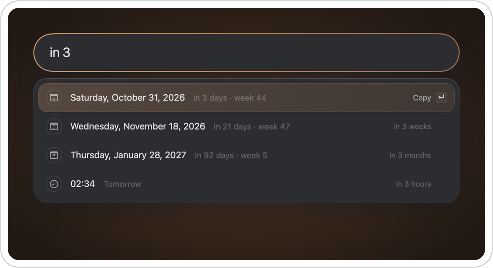</p>

**Math and money.** The answer appears as you type: percentages, currencies at today's rate, units and time zones. Enter copies it.

<p align="center">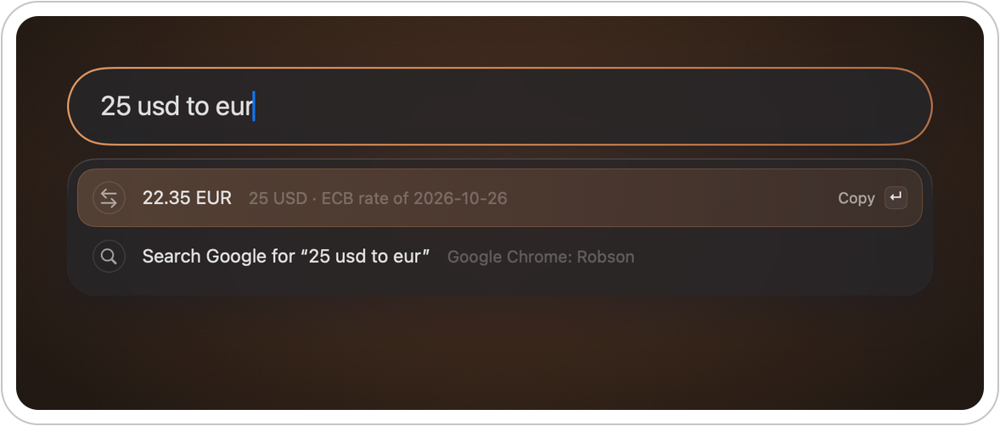</p>

**Little things, fast.** Emoji by name, UUIDs, passwords, JSON, colors and timestamps: type the tool's name, press Enter.

<p align="center">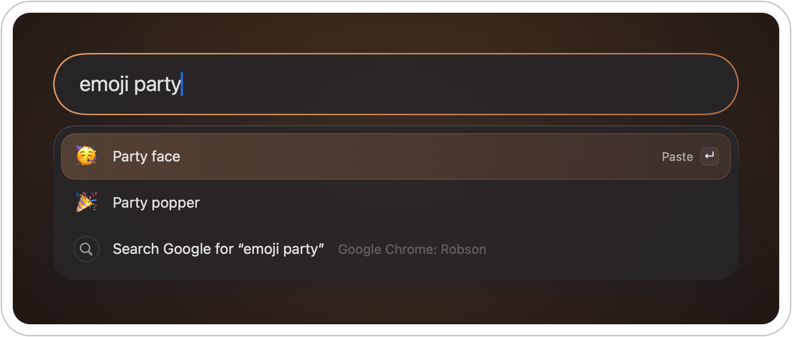</p>

**Commands.** Type `:` for windows, apps, files and the Mac itself: `:left`, `:quit saf`, `:dark`, `:lock`.

<p align="center">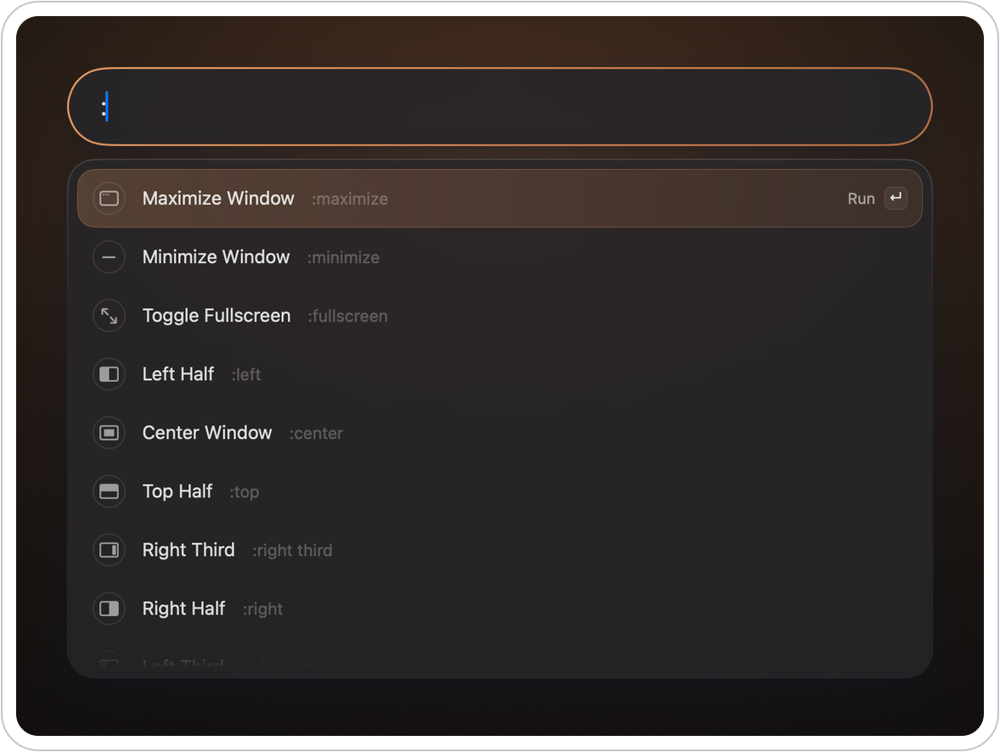</p>

**Words.** The Mac's dictionary in a preview beside the results, on-device translation, and every emoji by name.

<p align="center">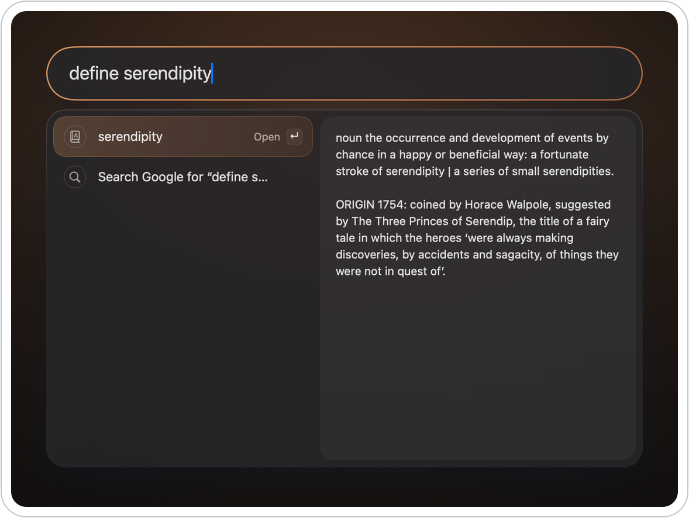</p>

## What you can type

A taste of what the field understands. Enter does the obvious thing: opens, copies, pastes or runs.

### Open and find

| Type | You get |
|---|---|
| `saf` | Safari; Enter opens it |
| `invoice` ⇥, `saf` ⇥ | What you can do with it: open with, reveal, copy the path or the file itself, trash; an app's recent documents, hide, quit or relaunch it. Its preview beside, Esc goes back |
| `figma`, an app you don't have | Install Figma with Homebrew, its output beside the row; then Enter opens it |
| `invoice` | Files and folders, from Spotlight's index (`f invoice`: files only) |
| `~/Downloads`, `/Applications` | That folder's contents, to go into or open |
| `copperlight git` | Bookmarks and recent pages from your browser, opened in their profile |
| `inbox`, `tabs` ⇥ | The tabs open in your browsers; Enter switches to it |
| `ana` | People from your contacts: Enter messages them, Tab for call, FaceTime, WhatsApp, email |
| `gmail.com`, `localhost:3000` | Opens it in your browser |
| anything | "Search Google for …" (or DuckDuckGo, Bing, Brave Search, Ecosia, Kagi), always last |

### Calculate and convert

The answer appears big as you type, with what a percentage hid beside it; Enter copies it.

| Type | You get |
|---|---|
| `20% of 150`, `150 + 20%`, `20% off 80` | `30`, `180`, `64` |
| `30 is what % of 150`, `10k * 3` | `20%`, `30000`; Tab puts the answer in the field, to keep going |
| `255 in hex` | `0xFF` |
| `25 usd to eur`, `39*8 usd`, `0.1 btc in eur` | The amount in euros at the live rate, big, with both flags behind it |
| `10 km in mi`, `30c` | `6.21 mi`, `86 °F` |
| `3pm lisbon in sf`, `now in tokyo` | The time there |
| `days until dec 25`, `in 3 weeks` | `58 days`, the date in 3 weeks; `dec 25` alone says it's a Friday |
| `stock AAPL`, `stock MGLU3.SA` | The price now, today's change and the last 7 days as a chart (from Yahoo Finance) |
| `weather`, `weather lisbon` | The weather now, the next hours and five days, where you are or in that city (from Open-Meteo) |

### Words

| Type | You get |
|---|---|
| `define laconic` | The entry from the Mac's dictionary, set like a page of one |
| `spell definately` | `definitely`, and the other guesses |
| `translate bom dia`, `translate thank you to japanese` | The translation, made on your Mac (macOS 26) |
| `translate`, `translate to spanish` | What you copied, translated |
| `translate hello world to ger` ⇥ | The language moves into the chip (Translate to German), so the field holds only your text |
| `emoji party` | Emoji by name; Enter pastes it |

### Clipboard and text

| Type | You get |
|---|---|
| `clip` | Everything you copied, text and images, searchable; Enter pastes it into the app you were in, Tab shows the rest: open a link, Large Type, a QR code, save a picture |
| `paste plain`, `paste markdown` | The clipboard without its formatting, or as Markdown (from web pages, Google Docs, Slack) |
| `json`, `upper`, `snake`, `b64`, `sha256` | The clipboard formatted, converted or hashed; or type the text after it: `upper hello` |
| `uuid`, `password 32`, `lorem 3` | A UUID, a password, placeholder text |
| `unix 1700000000`, `#ff8800` | `2023-11-14T22:13:20Z`, `rgb(255, 136, 0)` and `hsl(32, 100%, 50%)` |
| `pick color`, `colors` | A color off the screen, its hex copied; `colors` lists the ones you picked, newest first |
| `qr`, `qr https://copperlight.app` | A QR code of what you copied, or of what you type, beside the results |
| `copy text` | The text in any part of the screen you drag over, copied; a QR code's link opens |
| `large 555-0100`, `large` | The text across the screen, huge; `large` alone shows what you copied |

### Windows, apps and the Mac

| Type | You get |
|---|---|
| `:left`, `:top left`, `:left third`, `:maximize`, `:next display` | The window in front, moved there; `:restore` puts it back |
| `:nudge left` | The window in front, a step over; Enter again for another |
| `:layout save work`, `:layout work` | Every window on screen, saved by name, and put back where it was |
| `:window term` | Any window of any app, found by its title |
| `:export pdf`, `:new tab` | The menus of the app you're in, with their shortcuts |
| `:quit saf`, `:quit all`, `:hide others`, `:unhide all`, `:relaunch slack` | The apps that are running |
| `:open with readme`, `:trash readme`, `:terminal ~/code/app` | A file: open it with another app, move it to the Trash (asks first), or open its folder in your terminal |
| `:awake 2h`, `:awake until 18:00` | Your Mac kept awake for a while, then it lets go by itself; the time left ticks in the empty launcher |
| `:dark`, `:wifi`, `:awake`, `:lock`, `:show desktop`, `:log out`, `:empty trash` | The Mac itself; each row says what Enter does (Turn Wi-Fi Off), and the ones you can't undo ask first |
| `:play`, `:next track`, `:mute`, `:mute mic`, `:volume 30`, `:output airpods` | What's playing, in any app, where the sound goes, and your microphone |
| `:connect airpods` | Your paired Bluetooth devices: Enter connects one, or disconnects it if it's connected |
| `:shortcut name`, `:shortcut name some text` | Your Shortcuts, Focus modes included; text after the name is its input |
| `bluetooth`, `displays`, `dark mode` | That page of System Settings |
| `ip`, `battery`, `disk`, `port 3000` | Your IP addresses, the battery, free space, and what's listening on a port (Enter ends it) |
| `speed` | Your internet speed: download and upload big, and the latency, about 20 seconds after Enter |
| `cpu`, `memory`, `cpu chrome` | Your processes, the busiest first; Enter ends one (an app quits), after asking. Tab lists them all |

### Your day

| Type | You get |
|---|---|
| `week`, `next week` | Your week across the card, a column a day, each day's events with their times; Enter opens Calendar |
| `meetings`, `agenda`, `events` | The rest of today's events, a copper badge on what's soon; Tab shows the details (call link, people, notes), Enter joins the call. A few minutes before a call, it's already there when you open the launcher (or all of today, with Settings › Launcher › Calendar) |
| `add todo call mom tomorrow 5pm` | A reminder, due and alerting then |
| `due` | Reminders due today and overdue; Enter completes one. What's due soon waits when you open the launcher |
| `add event fri 10am dentist` | An event in your calendar |
| `note` ⇥, `note milk` ⇥, `new note`, `add note buy milk` | Floating notes, saved as you type: Tab on `note` lists only your notes, with a preview, and typing finds the one that says it |
| `:delete note milk` | Move a note to the Trash (asks first) |
| `pomo`, `pomo 50`, `pomo break` | A pomodoro, counting down in the menu bar |
| `timer 10 min tea`, `timer 90s`, `timer until 15:30` | A timer, counting down in the menu bar, with a sound when it's done |
| `stopwatch` | A stopwatch, counting up in the menu bar |
| `screenshot`, `record` | The macOS screenshot toolbar |

### Yours

| Type | You get |
|---|---|
| `gh copperlight` | Your quicklinks: a URL with what you typed filled in |
| `deploy staging` | Your scripts in `~/.config/copperlight/scripts/`, run with the text as arguments. Community script commands work as they are |
| `links docs` | A script that prints rows (`@output rows`): its name is a chip, the rows change as you type, and Enter opens or copies the one you pick |
| `sig`, `reply Ana` | Your snippets, placeholders filled in, pasted where you are |
| `:!git status` | A shell line, its output right in the launcher |

[All of it, in detail →](docs/guide.md)

## Install

Requires macOS 15 or later, on Apple silicon or Intel.

### Download

1. Download the zip from [Releases](https://github.com/ramosrob/copperlight/releases), unzip it and move
   Copperlight.app to Applications.
2. Open it. The first time, macOS asks you to confirm it: click **Done**, then open System Settings → Privacy &
   Security, scroll down to "Copperlight was blocked" and click **Open Anyway**. Only once.

   Or, in Terminal: `xattr -dr com.apple.quarantine /Applications/Copperlight.app`

Every release is signed with the same self-signed certificate, so updates keep the permissions you gave it.

### Build from source

Needs Xcode 26 or later (the full app: the Command Line Tools alone can't build it).

```sh
brew install xcodegen
git clone https://github.com/ramosrob/copperlight.git
cd copperlight
make install
```

`make install` builds a release copy into `~/Applications/Copperlight.app` and opens it. If `make` can't find
Xcode, select it once: `sudo xcode-select -s /Applications/Xcode.app && xcodebuild -runFirstLaunch`.

Builds are signed ad-hoc unless `make` knows your Apple team, and macOS forgets an ad-hoc app's permissions each
time it's rebuilt. If you'll rebuild it, see [Signing](DEVELOPMENT.md#signing).

### First launch

The first launch opens a welcome window: the hotkey, a button for each permission, and Open at Login. After
that Copperlight lives in the menu bar (the C), with no Dock icon. Press ⌥Space and type. Its menu has
**Settings…** (or type `copperlight settings`).

## Permissions

None are needed to start: search, math, files and most of the rest work without any. Each permission turns on a
few features. The welcome window asks for them in one place; otherwise macOS asks the first time a feature needs one.

| Permission | Turns on |
|---|---|
| Accessibility | Pasting into the app you were in (clipboard history, snippets, emoji, paste as Markdown); moving and switching windows; searching menus; `:play`, `:next track` |
| Calendars | `meetings` and `week` (read your events) and `add event` (add-only access is enough for that) |
| Reminders | `add todo`, and reminders that are due |
| Contacts | People as you type their name |
| Screen Recording | `copy text` (only the part you drag over is read) |
| Bluetooth | `:connect` (connecting and disconnecting your paired devices) |
| Notifications | The end of a pomodoro or a timer, shell lines that finish in the background, errors |
| Automation | Your browser's open tabs (asked once per browser, from `tabs` ⇥); `:empty trash`, `:dark`, `:restart`, `:shut down`, `:log out` (asking Finder, System Events or loginwindow) |
| Full Disk Access, by hand | Safari's bookmarks and history only |

## Privacy

- **No account, no analytics, no crash reports.** Nothing about you is sent anywhere.
- **Few network requests, none about you:** currency rates (Coinbase's public rates, every currency at once, so it
  never learns which one you convert) at most every 5 minutes, when you open the launcher, and for
  finding apps by what they do, Homebrew's public app list (downloaded whole, weekly, so it doesn't reveal which apps
  you have), each listed app's homepage once, and the App Store's description of apps you got there.
  `[apps] online = false` turns those off. Links and searches open in your browser.
- **Stock prices and weather only when you ask:** in the Stock chip (`stock aapl`, then Tab), the ticker goes to
  Yahoo Finance once you pause typing, and nothing else. In the Weather chip, the city, or where you are rounded to
  about a kilometer, goes to Open-Meteo the same way; Location Services is asked once, and a city in Settings does
  without it. Typing alone never sends it. Likewise your public IP: the `ip` row asks
  api.ipify.org only when you press Enter on Public IP, `speed` tests against Apple's servers only when you press
  Enter on it, and Homebrew downloads an app only when you press Enter on Install.
- **What it keeps stays on your Mac**, in `~/.config/copperlight/`: your config, notes, state and clipboard history
  (SQLite, readable only by you; deleted items are overwritten). Copies marked as passwords, and copies made in
  password managers, are never recorded.
- **Contacts, tabs and reminders are read on your Mac** when you open the launcher, and kept in memory only. The apps
  it suggests are learned from what you open with it, kept in `state.json`.
- **No AI service.** With Apple Intelligence on, the Mac's own on-device model writes search words for your apps.
  Nothing leaves the Mac.

## Make it yours

Everything lives in `~/.config/copperlight/config.toml`, created with commented examples on first run. Edit it in
**Settings…** or by hand: changes apply when you save. Settings › Features turns off whatever you don't use: its rows,
its commands and anything it does in the background go with it. Settings › Keywords gives any keyword words of your
own: `t` for `translate`, `;` for `:`.

```toml
[[command]]
alias = "gh"
type = "url"
url = "https://github.com/search?q={query}"   # "gh copperlight" searches GitHub

[[command]]
alias = "dev"
type = "shell"
run = "cd ~/code/api && docker compose up -d"

[[snippet]]
name = "reply"                                # "reply Ana"
text = "Hi {query}, thanks for the note. I'll get back to you by {date}."
```

Drop an executable into `~/.config/copperlight/scripts/` and it becomes a command too, community script commands
included. Every setting is in
[docs/configuration.md](docs/configuration.md).

## Documentation

| | |
|---|---|
| [Guide](docs/guide.md) | Everything you can type, in detail |
| [Configuration](docs/configuration.md) | config.toml and every setting in it |
| [Everything it does](FEATURES.md) | Every feature on one page |
| [Why it works this way](SPEC.md) | The principles behind it |
| [Developing](DEVELOPMENT.md) | Building, testing, releasing, and the rules a change has to fit |
| [Roadmap](ROADMAP.md) | What's next, what's later, and what's maybe someday |

## Support Copperlight

Copperlight is free, and it stays free. If it saves you time, you can
[sponsor it on GitHub](https://github.com/sponsors/ramosrob) or [buy me a coffee](https://buymeacoffee.com/ramosrob).
Found a bug or have an idea? [Open an issue](https://github.com/ramosrob/copperlight/issues).

## License

Copperlight is free and open source under the [GNU GPL v3](LICENSE). © 2026 Robson Ramos.
The search engines' logos are their owners' trademarks, shown only to name the engine a search goes to.
